# Datathon Equifax | Boa Vista 2026: modelo de credit scoring

**Equipe Bayes & Bytes** · Marcos Oshiro (Estatística e Ciência de Dados, ICMC-USP) e Vitor Lima dos Santos (Ciência da Computação, UFSCar) · Outubro de 2026

Código da solução da nossa equipe para o desafio **"Desvendando o Mundo do Crédito"**, proposto pela Equifax | Boa Vista no datathon da Semana da Estatística (SEST) 2026. O objetivo é estimar, no momento da concessão do crédito, a probabilidade de o cliente pagar em dia, e construir esse modelo de ponta a ponta: da análise exploratória à escoragem de uma base futura, passando por seleção de variáveis, feature engineering, dados macroeconômicos, interpretabilidade e produtização.

> **Versão pública: só o método, sem resultados.** A base do desafio é confidencial, e cada participante assinou um termo de confidencialidade. Por isso este repositório traz o código, os testes e os notebooks **sem as saídas**. Ficam de fora as bases, a OOT escorada, tudo o que foi calculado a partir delas (métricas, tabelas, gráficos, listas de variáveis selecionadas), o relatório técnico e a apresentação. Nos notebooks, as células de conclusão foram trocadas por um aviso. As imagens deste README vêm só do método, de dados públicos do BCB e do IBGE ou de uma base sintética; as sintéticas estão marcadas.

---

## O desafio

A proposta coloca a equipe no papel de cientistas de dados recém-contratados que precisam construir um modelo de concessão de crédito para um cliente da Equifax. O trabalho é dividido em três entregas incrementais, e cada uma precisa gerar um modelo diferente:

1. **M1, Modelo Base:** só as colunas fornecidas.
2. **M2, Feature Engineering:** variáveis novas criadas a partir das colunas fornecidas, com lógica de negócio.
3. **M3, Modelo Macro:** a base enriquecida com dados macroeconômicos públicos (juros, inflação, desemprego etc.), levando em conta o atraso de divulgação de cada série e como isso funcionaria em produção.

O modelo vencedor escora uma base **OOT (out-of-time) cega**, de meses posteriores aos do desenvolvimento e sem o target. Além da performance (AUC, KS, Gini e estabilidade entre safras), a avaliação considera a qualidade da análise exploratória, a lógica das features, a metodologia do macro, a interpretabilidade, a visão de negócio, a organização do código e a transparência sobre o uso de IA.

**Os dados:** uma base de desenvolvimento com concessões de crédito de 2023, mês a mês (a *safra*), com variáveis anônimas (`VP01`, `VP02`, ...), faixa de renda, faixa de idade, estado, CEP e o target `adimplencia` (1 = pagou). A OOT cega tem as mesmas colunas, sem o target. O score é `P(adimplencia = 1)`: quanto maior, menor o risco.

---

## Como resolvemos

Cada etapa é um notebook, rodado em ordem. Um lê o que o anterior gravou, e as funções ficam no pacote `src/equifax/`.

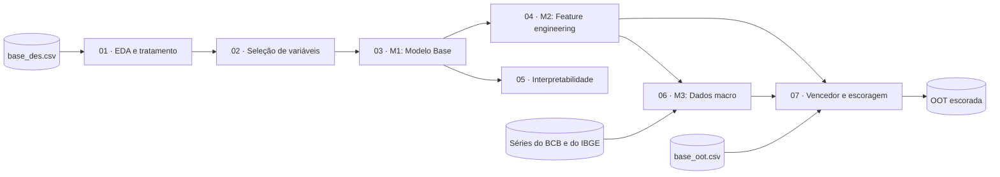

| Notebook | Etapa | O que faz |
|---|---|---|
| [`01_eda`](notebooks/01_eda.ipynb) | Análise exploratória e tratamento | Perfil dos clientes e inadimplência por safra, renda, idade e estado, com células pequenas marcadas. Tratamento do CEP, dos nulos e dos **códigos especiais** das VPs (`-1`, `-2` e `9999`), que ficam numa faixa própria em vez de virar nulo. |
| [`02_selecao_variaveis`](notebooks/02_selecao_variaveis.ipynb) | Seleção de variáveis | IV e WoE com binning ótimo, PSI por safra e correlação de Spearman (que não é distorcida pelos códigos especiais). Funil em que cada corte é medido num LightGBM com 3 sementes; uma variável de IV baixo só sai se o modelo também a usa pouco. |
| [`03_modelo_base`](notebooks/03_modelo_base.ipynb) | M1 | Logística com WoE (scorecard, com L1 ou L2 escolhido na validação cruzada), LightGBM e XGBoost ajustados com Optuna em validação cruzada agrupada por cliente. Avaliação com KS por safra, ROC, decis, PSI do score, calibração e simulação de política de aprovação. |
| [`04_feature_engineering`](notebooks/04_feature_engineering.ipynb) | M2 | Quatro famílias de variáveis, cada uma com hipótese de negócio e medida por ablação: contagens de códigos especiais por linha, renda relativa ao estado e à região, interações renda × idade e idade × região, e CEP (taxa por prefixo calculada fora da dobra, CEP genérico, ausente e coerência com o estado). |
| [`05_interpretabilidade_escoragem`](notebooks/05_interpretabilidade_escoragem.ipynb) | Interpretabilidade e ensaio da escoragem | SHAP exato (TreeSHAP), com a conferência de que valor base + contribuições reproduz o score de cada cliente. Dependência, explicação de clientes individuais, estabilidade da explicação entre safras e comparação com a logística. |
| [`06_modelo_macro`](notebooks/06_modelo_macro.ipynb) | Dados macro e M3 | Oito séries públicas do Banco Central e do IBGE juntadas **sem vazamento**, avaliadas em meses posteriores aos do treino para o modelo não "decorar o mês". |
| [`07_modelo_final`](notebooks/07_modelo_final.ipynb) | Modelo vencedor e escoragem | Escolha do vencedor por uma regra escrita antes, confirmação única na OOT interna, desempenho por perfil de cliente, retreino com todas as safras e escoragem da OOT cega com conferências. |

### Protocolo de validação

<p align="center">
  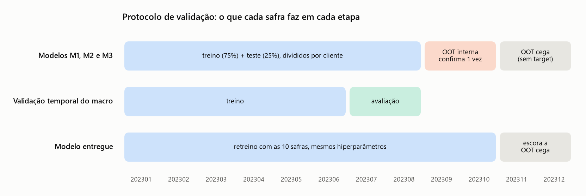
</p>

- **A OOT nunca influencia decisões.** Hiperparâmetros são ajustados por validação cruzada só no treino, e o teste compara os finalistas. A OOT interna é usada uma única vez, depois da escolha; o código exige pedir explicitamente para usá-la.
- **O ruído como régua.** Cada comparação roda com 3 sementes, e uma diferença só conta como ganho quando supera o desvio entre elas. Essa régua decide os cortes de variáveis, o M2, o M3 e o vencedor.
- **Critério do vencedor escrito antes e em código** (`experimentos.escolher_vencedor`, com testes): do modelo mais simples para o mais complexo, um só substitui o outro se ganhar acima do ruído no teste e nos meses novos, sem piorar o pior mês. Entre empatados, fica o mais simples.
- **Tudo que aprende com os dados é ajustado só no treino:** binning do WoE, categorias, medianas e taxa de inadimplência por prefixo de CEP (calculada fora da dobra).
- **Rastreabilidade:** cada execução de modelo vira uma linha num registro de experimentos, com parâmetros, métricas, tempo de treino e commit do Git.

### Dados macro sem vazamento e em produção

Detalhes em [`docs/macro_catalogo.md`](docs/macro_catalogo.md).

- Cada concessão é tratada como feita no **dia 1 do mês da safra**, e cada série só vale depois da sua defasagem de divulgação, fixa e conservadora (por exemplo, 2 meses para o IPCA e 4 para a desocupação por estado).
- As séries por estado usam o `estado` do cliente; as nacionais têm um valor por mês para todos.
- Em produção, a coleta é agendada e guarda cada download numa pasta datada com um manifesto. O modelo usa o último valor já divulgado e registra a idade do dado. Um alerta dispara quando uma série atrasa além do esperado, e o plano B é o modelo sem macro.

<p align="center">
  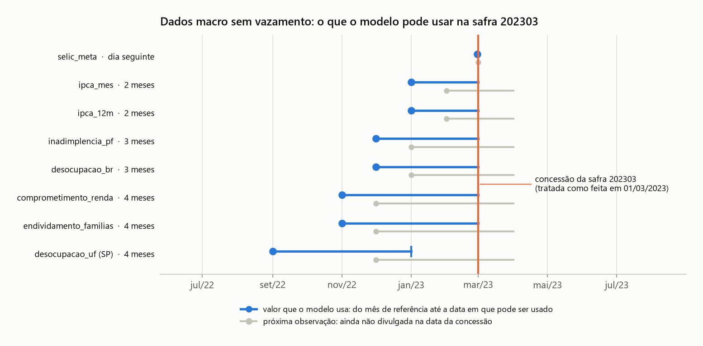
</p>

As séries que entram no M3, com o período das safras destacado. São dados públicos, baixados das APIs do BCB e do IBGE e versionados com a data do download:

<p align="center">
  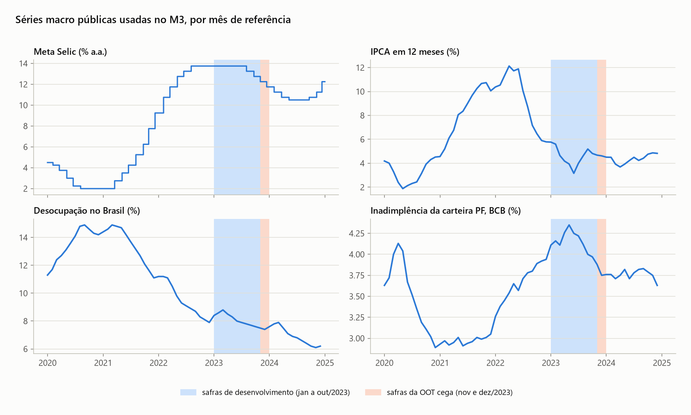
</p>

<p align="center">
  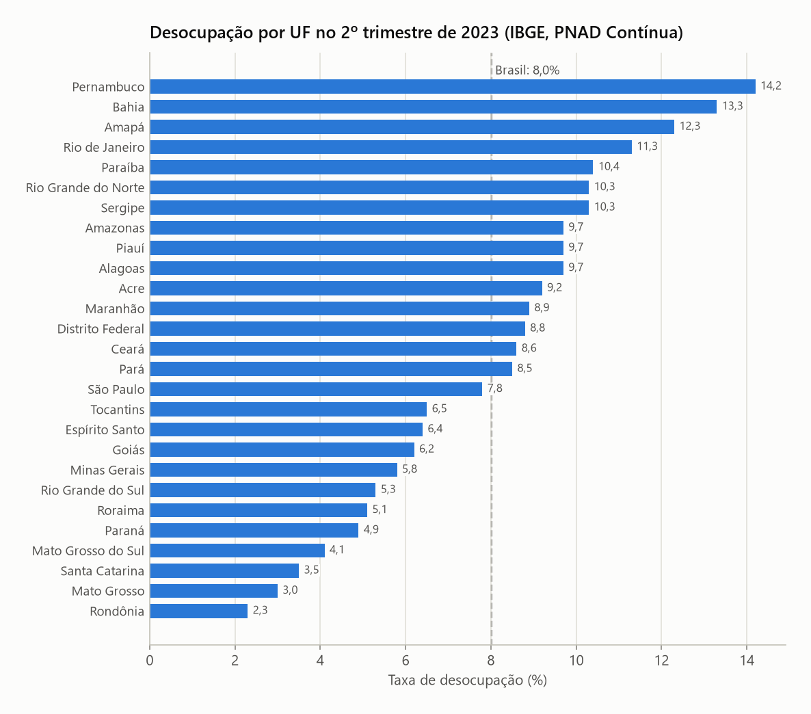
</p>

---

## O que o pipeline produz (dados sintéticos)

Os gráficos abaixo saem das **mesmas funções** usadas nos notebooks (`avaliacao` e `explicar`), rodadas numa base **sintética**, gerada com variáveis inventadas (`sint_01`, `sint_02`, ...) e efeitos inventados. Eles mostram o tipo de análise que fizemos em cada etapa, **não os resultados do datathon**. O script [`scripts/visuais_publicos.py`](scripts/visuais_publicos.py) gera todas as imagens deste README sem ler a base.

<table>
  <tr>
    <td width="50%">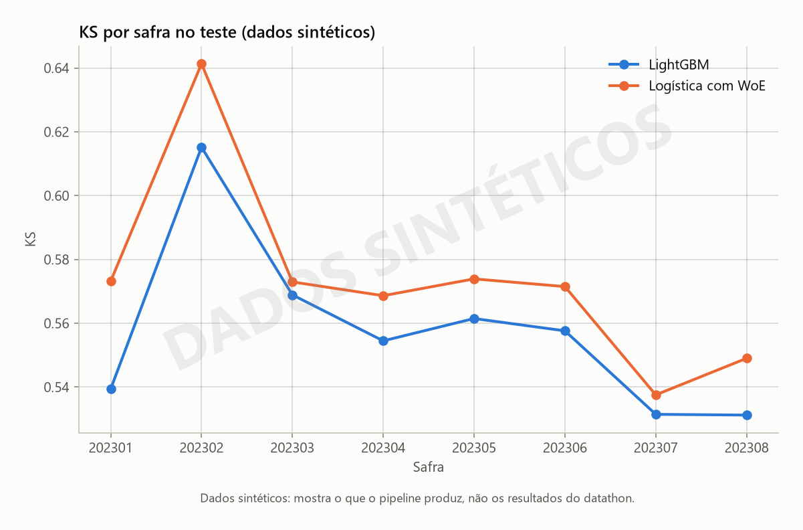</td>
    <td width="50%">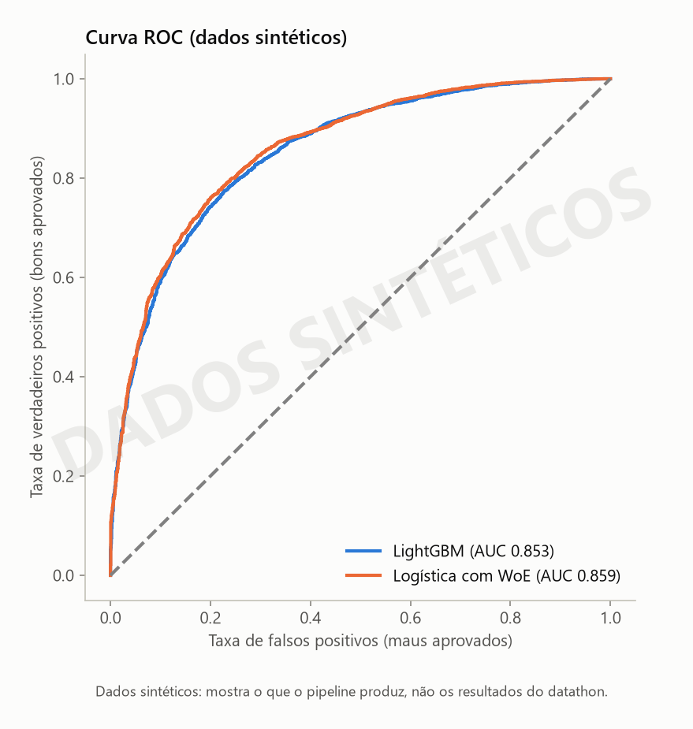</td>
  </tr>
  <tr>
    <td><b>Estabilidade:</b> KS de cada safra do teste, para ver se o poder de separação se mantém no tempo.</td>
    <td><b>Discriminação:</b> curva ROC e AUC do LightGBM e da logística com WoE.</td>
  </tr>
  <tr>
    <td>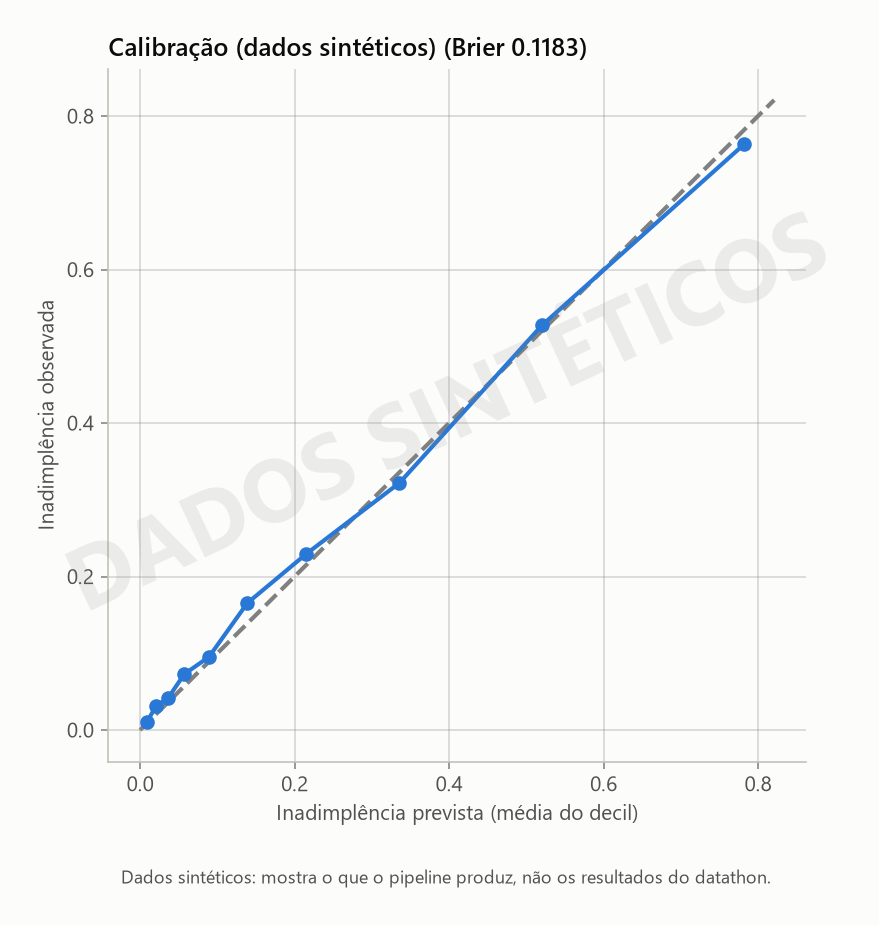</td>
    <td>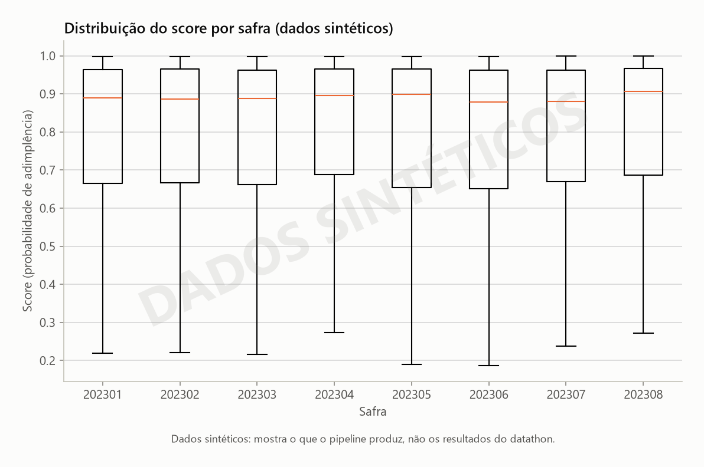</td>
  </tr>
  <tr>
    <td><b>Calibração:</b> inadimplência prevista contra a observada em cada decil; perto da diagonal, o score pode ser lido como probabilidade.</td>
    <td><b>Distribuição do score por safra:</b> se a forma muda muito de um mês para outro, o modelo está instável.</td>
  </tr>
  <tr>
    <td>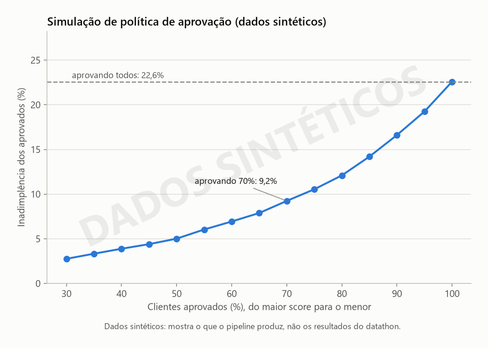</td>
    <td>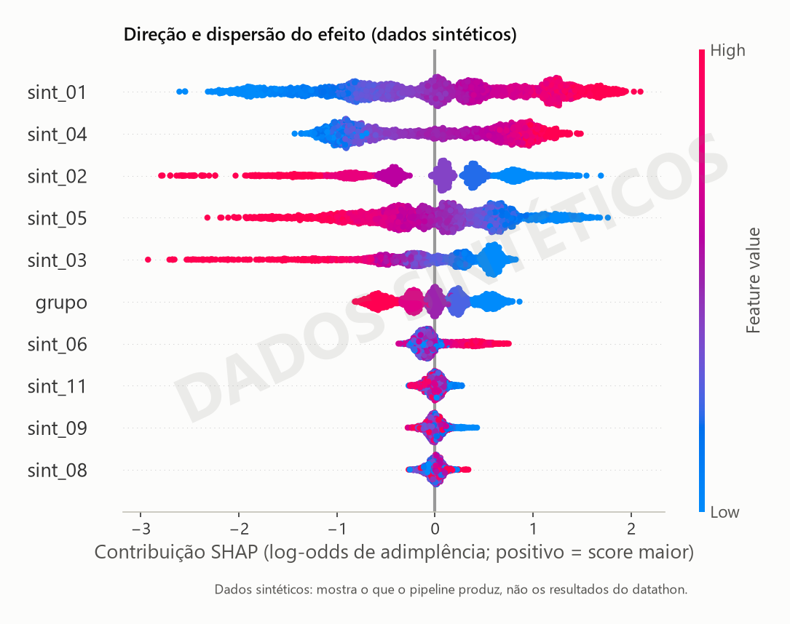</td>
  </tr>
  <tr>
    <td><b>Visão de negócio:</b> aprovando os clientes de maior score, quanto cai a inadimplência entre os aprovados.</td>
    <td><b>Interpretabilidade:</b> SHAP exato; a posição é o efeito no score e a cor é o valor da variável.</td>
  </tr>
  <tr>
    <td>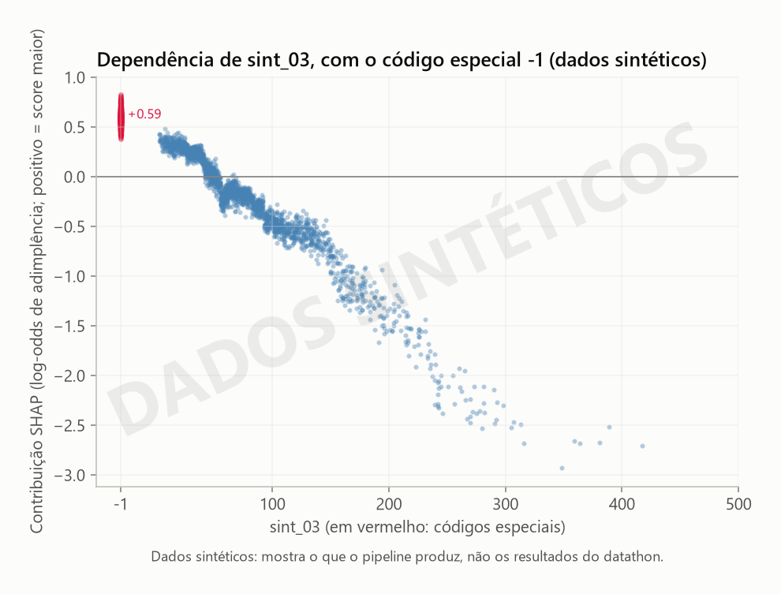</td>
    <td>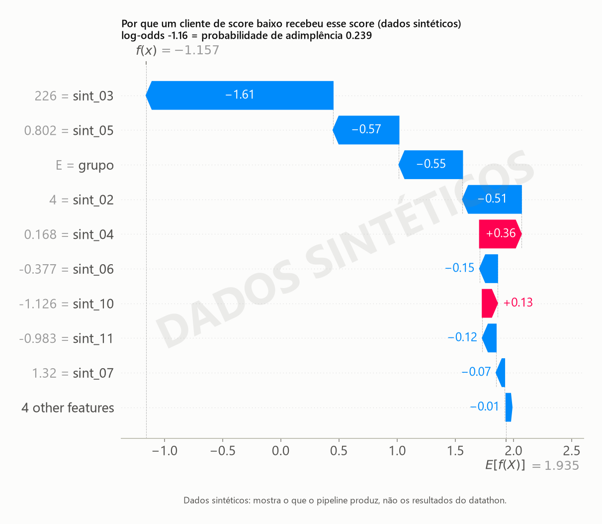</td>
  </tr>
  <tr>
    <td><b>Códigos especiais:</b> o <code>-1</code> fica numa posição própria, com o efeito médio escrito, em vez de virar um número da escala.</td>
    <td><b>Um cliente:</b> do valor base até o score, somando a contribuição de cada variável.</td>
  </tr>
</table>

---

## Estrutura do repositório

```
src/equifax/                  pacote Python com as funções de cada etapa
notebooks/                    01_eda a 07_modelo_final, sem as saídas
data/external/macro_bruto/    séries macro públicas do BCB e do IBGE, com manifesto
docs/                         uso de IA, catálogo das séries macro e imagens do README
scripts/visuais_publicos.py   gera as imagens do README sem ler a base
tests/                        testes automatizados com dados inventados
```

As pastas `config/`, `reports/`, `models/`, `submission/` e `data/raw/` existem vazias: os notebooks gravam nelas listas de variáveis, figuras, tabelas, modelos e a OOT escorada, que ficam fora do Git.

| Módulo (`src/equifax/`) | O que faz |
|---|---|
| `config` | Caminhos e semente fixa (`RANDOM_SEED = 42`) |
| `tratamento` | Tratamento da base, o mesmo para o desenvolvimento e a OOT |
| `validacao` | Divisão por cliente e métricas (AUC, Gini e KS no total e por safra) |
| `viz` | Tabelas e gráficos da EDA |
| `selecao` | IV, WoE, PSI e correlação, com os códigos especiais em faixa própria |
| `dados`, `conjuntos` | Leitura da base, janelas de safras e listas de variáveis nomeadas |
| `experimentos`, `ajuste` | Treino, avaliação e registro dos modelos; validação cruzada no treino; regra do vencedor |
| `modelos` | Regressão logística com WoE (scorecard) |
| `avaliacao` | Decis, PSI, calibração e cenários de política de crédito |
| `features` | Famílias de variáveis do M2 |
| `macro` | Coleta das séries do BCB e do IBGE e junção sem vazamento |
| `explicar` | SHAP |
| `escoragem` | Escoragem de um CSV bruto, com conferências antes de gravar |

---

## Como reproduzir

### Ambiente (Windows / PowerShell)

Pré-requisitos: Git e Python 3.12.

```powershell
# 1. Clonar
git clone <url-deste-repositorio>
cd <pasta-do-repositorio>

# 2. Ambiente virtual
py -3.12 -m venv .venv
.\.venv\Scripts\Activate.ps1          # o prompt deve passar a mostrar (.venv)

# 3. Dependências (versões exatas) + pacote local
python -m pip install --upgrade pip
pip install -r requirements-lock.txt   # ambiente idêntico ao da equipe
pip install -e .                        # pacote 'equifax' editável (não está no lock)

# 4. Notebooks: filtro que remove as saídas no commit (rodar uma vez por clone)
nbstripout --install

# 5. Registrar o kernel do Jupyter
python -m ipykernel install --user --name equifax --display-name "Python (equifax)"
```

> **Importante:** reative o `.venv` (`.\.venv\Scripts\Activate.ps1`) toda vez que abrir um PowerShell novo, antes de qualquer `pip` ou `python`. E rode **os dois** installs do passo 3: o `pip install -e .` não aparece no lock.

### Sem as bases

Os testes usam dados inventados e rodam sem as bases originais:

```powershell
pytest
```

As imagens deste README também saem sem as bases:

```powershell
python scripts/visuais_publicos.py
```

### Com as bases

As bases foram cedidas pela Equifax | Boa Vista só para o datathon e **não** estão neste repositório (os CSVs são bloqueados pelo `.gitignore`). Para rodar os notebooks, coloque os arquivos originais em `data/raw/base_des.csv` e `data/raw/base_oot.csv`.

Camadas de dados:
- `data/raw/`: bruto, somente leitura
- `data/interim/`: estágios intermediários
- `data/processed/`: pronto para modelagem (ex.: `base_des_01.csv`)
- `data/external/`: dados macroeconômicos (Passo 7)

Os notebooks rodam em ordem, de `01` a `07`. Cada um lê o que o anterior gravou (`config/conjuntos.yaml`, `reports/params_m1.json`, `variaveis_m2.json`, `variaveis_m3.json` e `experimentos.csv`), e o `07` precisa do `04` e do `06` rodados antes. As buscas de hiperparâmetros do `03` levam cerca de 2 horas; os outros notebooks, de 10 a 40 minutos. Para rodar um notebook inteiro pelo terminal:

```powershell
python -m jupyter nbconvert --to notebook --execute --inplace --ExecutePreprocessor.timeout=-1 notebooks/04_feature_engineering.ipynb
```

### Passos do projeto

Numeração das etapas usada no código e nos notebooks ("Passo 1", "Passo 4" etc.):

| Passo | Tema | Passo | Tema |
|---|---|---|---|
| 0 | Ambiente e repositório | 7 | Dados macro |
| 0.5 | Auditoria e congelamento das bases | 8 | Modelo vencedor |
| 1 | Validação temporal e métricas | 9 | Interpretabilidade |
| 2 | EDA (perfil e inadimplência) | 10 | Escorar a OOT |
| 3 | Tratamento | 11 | Relatório |
| 4 | Seleção de variáveis (PSI, WoE, IV) | 12 | Apresentação |
| 5 | Modelo base | 13 | Conferência final |
| 6 | Feature engineering | | |

### Regras do projeto

- **A OOT nunca influencia decisões** (features, transformações, hiperparâmetros). Pode ser olhada só para entender esquema, tipos e distribuições gerais.
- Semente fixa do projeto: `RANDOM_SEED = 42` (em `src/equifax/config.py`).
- Nada calculado a partir da base vai para o Git: saídas dos notebooks, figuras, tabelas, registro de experimentos e listas de variáveis ficam só na máquina de quem roda (termo de confidencialidade do datathon). Mantenha o `nbstripout` instalado.

---

## Uso de IA

O edital pedia transparência sobre o uso de IA. Usamos o Claude (Anthropic) como apoio para organizar o código, revisar textos, discutir resultados e propor algumas análises. As decisões são da equipe, e tudo foi revisado antes de entrar no projeto. As etapas com auxílio de IA estão marcadas com `[IA]` no código e nos notebooks. **A IA nunca recebeu linhas das bases**, só código, nomes de colunas e resultados agregados. Detalhes em [`docs/uso_ia.md`](docs/uso_ia.md).

---

## Equipe

| | Curso | Universidade |
|---|---|---|
| **Marcos Oshiro** | Estatística e Ciência de Dados | ICMC-USP |
| **Vitor Lima dos Santos** | Ciência da Computação | UFSCar |

Agradecemos à Equifax | Boa Vista pelo desafio e pela base, e à organização da Semana da Estatística.
